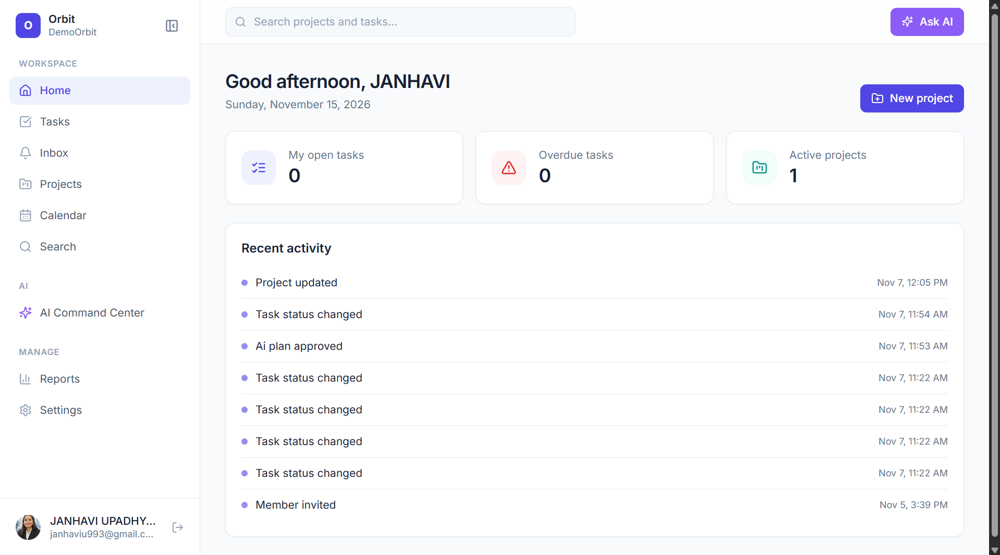
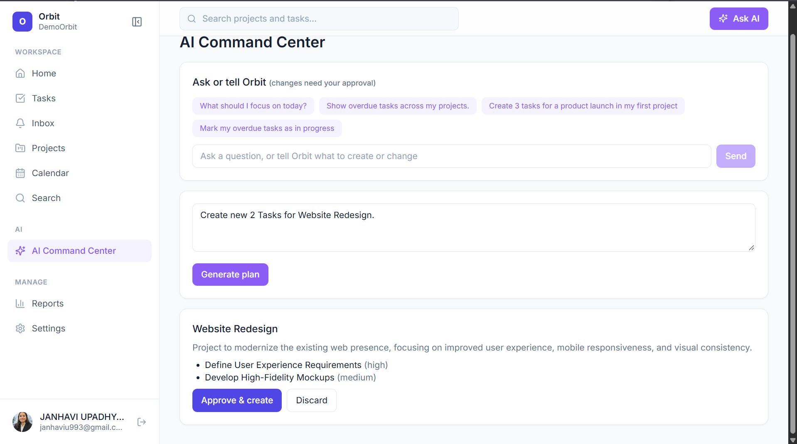
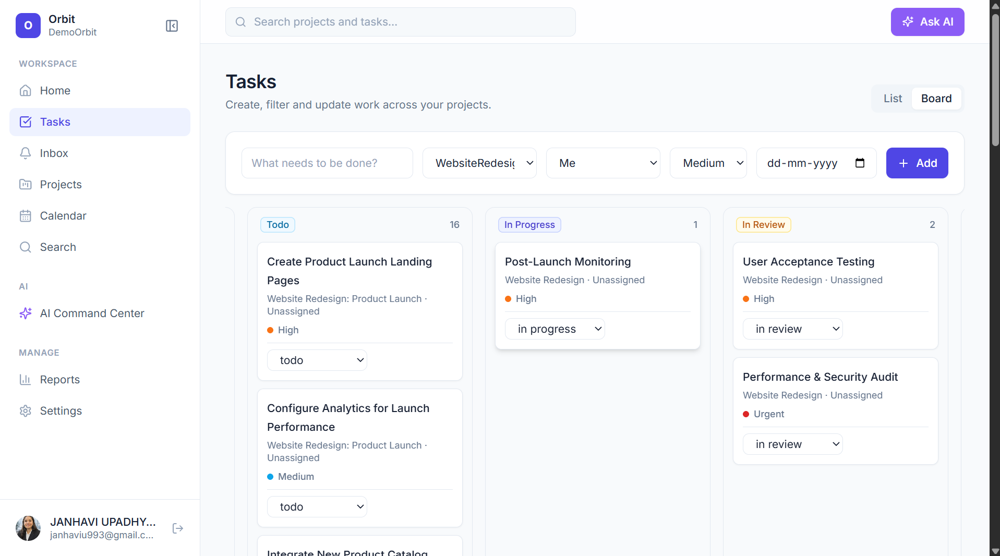
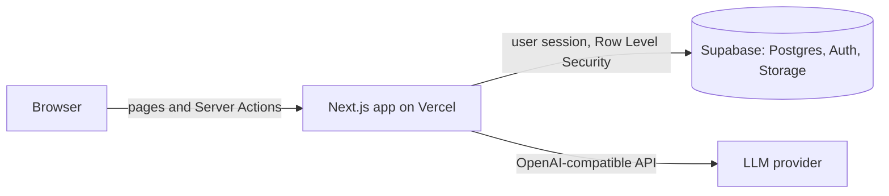
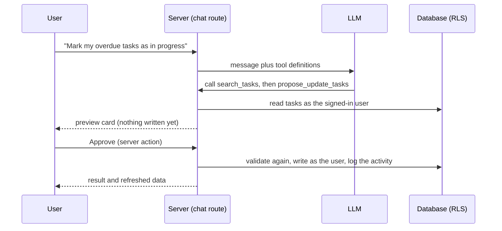

# Orbit Workspace

A multi-tenant team workspace with an AI assistant that **proposes changes and waits for your approval**. Describe the work in plain language, review a preview, and approve it to create or update projects and tasks.

Full-stack TypeScript: Next.js 15, Supabase (PostgreSQL with Row Level Security) and an OpenAI-compatible LLM.

> **Portfolio project.** Built to practice production-style full-stack engineering: database-level multi-tenancy, a safe human-in-the-loop AI design, and the usual product surface (auth, roles, invites, CRUD, search, reports). It is not a commercial product.

**Live demo:** https://orbit-workspace-theta.vercel.app

## Screenshots

| Home | AI approval preview |
|---|---|
|  |  |




---

## Contents

1. [What this project demonstrates](#what-this-project-demonstrates)
2. [Features](#features)
3. [Architecture](#architecture)
4. [Key engineering decisions](#key-engineering-decisions)
5. [Tech stack](#tech-stack)
6. [Getting started](#getting-started)
7. [Configuration](#configuration)
8. [Database](#database)
9. [Roles and permissions](#roles-and-permissions)
10. [Project structure](#project-structure)
11. [Testing](#testing)
12. [Deployment](#deployment)
13. [Troubleshooting](#troubleshooting)
14. [Limitations and future work](#limitations-and-future-work)
15. [Development approach](#development-approach)

---

## What this project demonstrates

- **Multi-tenant data isolation enforced in the database.** Row Level Security on every tenant table, `SECURITY DEFINER` functions for role and membership changes, and triggers that stop a record from being attached to another organization.
- **AI with a safety boundary.** The model can only call validated tools. Reads run as the signed-in user, writes are prepared as a preview and applied only after explicit approval, then re-validated on the server.
- **Server-side validation and authorization everywhere.** Zod at every boundary (forms, server actions, AI tool arguments). Permissions are enforced by the database, not by hiding buttons.
- **Real concurrency and integrity concerns.** Circular task dependencies are rejected inside Postgres, with a per-organization advisory lock so two simultaneous requests cannot create a cycle together.
- **Practical performance work.** Per-request caching, parallel queries, optimistic UI, loading skeletons, and co-locating the hosting region with the database.
- **Provider-agnostic AI.** The same code runs against OpenAI, Google Gemini or Groq by changing environment variables.
- **Product completeness.** Email, Google and GitHub sign-in, password reset, invitations, profile photo upload, audit trail, reports, a public landing page, and a documented deployment.

---

## Features

**Workspace**
- Organizations with three roles: owner, admin, member. Invite teammates with a link that only works for the invited email address and expires after 7 days.
- Projects with status (planning, active, on hold, completed, archived), dates, owner and progress (done tasks divided by non-cancelled tasks). Archive and delete (deleting needs owner/admin and typing the project name).
- Tasks with status, priority, due date, assignee, description, subtasks (one level), dependencies and comments. Deleting is limited to the creator or an admin.
- List, board and month-calendar views. Filters for status, priority and assignee. Status changes apply instantly with a saving indicator.
- Global search, notifications for new comments, an activity log, and reports (status counts, overdue work, workload, 7/30/90-day ranges).
- Profile page: display name, photo upload (PNG, JPG or WebP up to 2 MB) and password change.
- Collapsible sidebar that remembers its state, loading skeletons, a "Get started" checklist and a one-click sample project.

**AI Command Center**
- Ask questions about your real data ("What should I focus on today?", "Show overdue tasks") and get answers with links to the records used.
- Tell it to create or change tasks. It shows a preview card and **nothing happens until you click Approve**.
- Generate a project plan, review it, and approve it to create the project and its tasks.

**Auth and public pages**
- Email and password, Google and GitHub sign-in, forgot and reset password.
- Public landing page with a waitlist form (`/welcome`) and Privacy and Terms page templates (templates only, not legal advice).

---

## Architecture



**How an AI change is made safely**



Business rules live in `src/lib` and in server actions, not in page components. Pages are server components that fetch their own data. Small client components handle interaction (status select, sidebar, forms).

---

## Key engineering decisions

**1. Tenant isolation lives in the database.**
Every tenant table has an `org_id` and Row Level Security policies built on `is_org_member()` and `is_org_admin()`. Application code runs queries as the signed-in user, so even a bug in a page cannot read another organization's data. Triggers derive or verify `org_id` for comments, dependencies and subtasks. *Trade-off:* more SQL to maintain, and proper verification needs a real database (see [Testing](#testing)).

**2. The AI proposes, the human approves.**
The model never gets database credentials or free-form SQL. It calls small, Zod-validated tools. Read tools run under the user's own session. Write tools only build a preview; the actual write happens in a server action after the user clicks Approve, which re-validates the proposal, records it in the audit log, and ignores a second approval of the same proposal. Stored text (task titles and so on) is treated as untrusted data. *Trade-off:* one extra click per AI change, which is the point.

**3. Tolerating weaker models.**
Free and small models send `null` for unused fields, capitalise enums oddly, or pass names instead of UUIDs. Tool arguments are normalised before validation, and project and task names are resolved on the server with clear error messages the model can correct from. The tool loop has a step cap and, when it runs out, forces a final answer from the data already retrieved instead of failing.

**4. Cycle-free dependencies, enforced in Postgres.**
A trigger checks new dependency edges with a recursive query and rejects any that would form a cycle, including indirect ones. An advisory lock per organization serialises concurrent inserts so two requests cannot jointly create a cycle. *Trade-off:* inserts for one organization briefly queue.

**5. Validation and error handling at the boundary.**
Server actions validate with Zod and report problems through redirect codes (`?error=...`) so users see an inline message rather than a crash overlay. Public forms use `useActionState`, a hidden honeypot field, and in-memory rate limits. The password-reset form gives the same answer whether or not an account exists. Redirect targets (`next=`) are restricted to same-site paths.

**6. Performance.**
`React.cache()` makes the layout and the page share one user/organization lookup per request. Queries run in parallel with `Promise.all`. Status changes are optimistic with rollback on failure. `loading.tsx` shows a skeleton instantly. The hosting region is matched to the Supabase region. The middleware only checks the session cookie locally; every page, server action and API route still verifies the user with `auth.getUser()`, and the database enforces access regardless. *Trade-off:* the middleware is a convenience redirect, not the security boundary, and that is documented in the code.

**7. File uploads.**
Profile photos are checked by their actual file signature (not just the extension or browser-reported type), limited to 2 MB, and stored under per-user Storage policies so a user can only write inside their own folder.

**8. Provider-agnostic AI.**
`OPENAI_BASE_URL` and `OPENAI_MODEL` select the provider. The app has been wired for OpenAI, Gemini and Groq without code changes.

---

## Tech stack

| Area | Technology |
|---|---|
| Framework | Next.js 15 (App Router, Server Actions), React 19, TypeScript (strict) |
| Styling | Tailwind CSS 3, Lucide icons, Inter |
| Database and auth | Supabase: PostgreSQL, Row Level Security, Auth, Storage |
| AI | `openai` SDK against any OpenAI-compatible provider |
| Validation | Zod |
| Tests | Vitest |
| Hosting | Vercel |

---

## Getting started

**Prerequisites:** Node.js 20 or newer, a free [Supabase](https://supabase.com) account, and optionally an AI provider key.

```bash
npm install
cp .env.example .env.local        # Windows PowerShell: copy .env.example .env.local
# fill in .env.local, create the database (see "Database"), then:
npm run dev
```

Open http://localhost:3000, sign up, and create an organization. You become its owner.

**Try it in three minutes**
1. On Home, click **Load sample project**. It adds example tasks, some overdue and one blocked.
2. Open **AI Command Center** and type: `Mark my overdue tasks as in progress`.
3. Review the preview card, click **Approve**, then open **Tasks** to see the result.

---

## Configuration

| Variable | Required | Description |
|---|---|---|
| `NEXT_PUBLIC_SUPABASE_URL` | Yes | Base project URL, like `https://abcd1234.supabase.co` (no path, no trailing slash) |
| `NEXT_PUBLIC_SUPABASE_ANON_KEY` | Yes | The `anon` (or "publishable") key from Supabase Project Settings, API |
| `OPENAI_API_KEY` | For AI | Key for your AI provider. Without it, AI pages show "not configured" |
| `OPENAI_BASE_URL` | No | Empty for OpenAI. Set it for another provider |
| `OPENAI_MODEL` | No | Model name. Defaults to `gpt-4o-mini` |

Never put the Supabase **service-role** or **secret** key in this file; the app does not use it. `.env.local` is git-ignored. Restart the dev server after editing it.

**AI provider examples**

```dotenv
# OpenAI
OPENAI_API_KEY=sk-...
OPENAI_MODEL=gpt-4o-mini

# Google Gemini (OpenAI-compatible endpoint)
OPENAI_API_KEY=<gemini key>
OPENAI_BASE_URL=https://generativelanguage.googleapis.com/v1beta/openai/
OPENAI_MODEL=gemini-2.5-flash

# Groq
OPENAI_API_KEY=<groq key>
OPENAI_BASE_URL=https://api.groq.com/openai/v1
OPENAI_MODEL=openai/gpt-oss-120b
```

Model names change often. List what your key can use with `GET <OPENAI_BASE_URL>/models` (header `Authorization: Bearer <key>`) and copy a name exactly. Free models are weaker at tool calling than paid ones.

**Supabase auth settings**
1. **Authentication, Providers:** enable Email. For Google and GitHub, enable each provider and paste its client ID and secret. In the Google/GitHub console, the callback URL is the one shown on the Supabase provider page (`https://<project>.supabase.co/auth/v1/callback`), not your app's address.
2. **Authentication, URL Configuration:** set **Site URL** to your app's URL, and add `http://localhost:3000/auth/callback` and your deployed `/auth/callback` to **Redirect URLs**.
3. **Email:** Supabase's built-in email service only sends to your own project team and is heavily rate limited. To let other people receive confirmation and password-reset emails, configure custom SMTP (Authentication, Emails, SMTP Settings). Until then, keep **Confirm email** off.

---

## Database

All schema lives in `supabase/migrations/`. Apply the files **in order** in the Supabase SQL Editor (one at a time), or with the Supabase CLI (`supabase db push`).

| # | File | Adds |
|---|---|---|
| 0001 | `0001_core.sql` | organizations, members, projects, tasks, activities, helper functions, RLS |
| 0002 | `0002_comments_notifications.sql` | comments, notifications (created by a trigger on new comments) |
| 0003 | `0003_members_invitations.sql` | invitations, member listing, role changes, member removal, invite acceptance |
| 0004 | `0004_subtasks_dependencies.sql` | subtasks, task dependencies with cycle detection |
| 0005 | `0005_profiles.sql` | profiles (name, photo), created automatically for new users |
| 0006 | `0006_avatars.sql` | public `avatars` storage bucket with per-user policies |
| 0007 | `0007_project_delete_admin.sql` | only owners and admins can delete projects |
| 0008 | `0008_waitlist.sql` | insert-only waitlist table |
| 0009 | `0009_task_delete.sql` | creators can delete their own tasks, admins can delete any |

Running a file twice fails with "already exists", which is harmless.

**Tables:** `organizations`, `organization_members`, `projects`, `tasks` (with `parent_id`), `task_dependencies`, `comments`, `notifications`, `activities`, `invitations`, `profiles`, `waitlist`.

**Progress rule (documented, not guessed):** a project's progress is done tasks divided by non-cancelled tasks, rounded to a whole percent.

---

## Roles and permissions

Enforced by Row Level Security and database functions, not just by hiding buttons.

| Action | Owner | Admin | Member |
|---|:-:|:-:|:-:|
| View all projects, tasks and comments in the organization | Yes | Yes | Yes |
| Create and edit projects and tasks, comment | Yes | Yes | Yes |
| Delete a task | Any | Any | Own tasks only |
| Delete a project | Yes | Yes | No |
| Invite people, revoke invites | Yes | Yes | No |
| Change a member's role | Yes | No | No |
| Remove a member | Anyone but the owner | Members only | Leave only |

The owner role cannot be assigned, changed or removed through the app.

---

## Project structure

```
src/
  app/
    (workspace)/         Pages behind sign-in (Home, tasks, projects, calendar, inbox, search,
                         reports, settings, profile, ai) plus actions.ts (server actions)
    (legal)/             Privacy and Terms templates
    api/ai/              chat and plan endpoints
    auth/callback/       Return point for social sign-in and password-reset emails
    forgot-password/  reset-password/  invite/[token]/  login/  welcome/
  components/            Sidebar, app frame, UI primitives, task status select, onboarding
  lib/
    context.ts           Per-request user, organization and role (cached)
    schemas.ts           Zod schemas and the progress rule
    ai-tools.ts          Read-only AI tools
    ai-propose.ts        AI tools that build previews (never write)
    ai-error.ts  ratelimit.ts  report.ts  sample.ts  legal.ts
    supabase/            Server and browser clients
  middleware.ts          Redirects visitors who are not signed in
supabase/migrations/     Database schema
tests/
  unit/                  Vitest unit tests
  integration/           Row Level Security tests (need a Supabase test project)
```

---

## Testing

```bash
npm test
```

- **Unit tests (21, Vitest)** cover validation schemas, the progress rule, report calculations, the rate limiter and search escaping. They pass.
- **Type checking:** `npx tsc --noEmit` is clean.
- **Row Level Security integration tests** (`tests/integration/tenant-isolation.test.ts`) check cross-organization reads and writes, invitation rules, role limits, dependency cycles and subtask rules against a real database. They are skipped unless configured. **They are written but have not yet been run against a live project**, so the isolation guarantees above are designed and reviewed, not yet verified by that suite. To run them, use a throwaway Supabase project with migrations 0001 to 0009 applied:

  ```bash
  TEST_SUPABASE_URL=...  TEST_SUPABASE_ANON_KEY=...  TEST_SUPABASE_SERVICE_ROLE_KEY=...  npm test
  ```

  On Windows PowerShell set the variables first (`$env:TEST_SUPABASE_URL="..."`). The service-role key is used only by these tests to create and delete test users; the app never uses it.
- **Not covered:** browser end-to-end tests, automated tests for the AI tools, and ESLint (the `lint` script exists but ESLint is not configured).

---

## Deployment

Deployed on Vercel with Supabase as the backend.
1. Push the repository to GitHub and import it in Vercel.
2. Add the environment variables from [Configuration](#configuration). Vercel does not read `.env.local`.
3. Set the Vercel **Function Region** to match your Supabase region (for a project in Paris, `cdg1`). Running far from the database makes every page slow, because each page makes several queries.
4. Add the deployed URL and `/auth/callback` to Supabase URL Configuration.
5. Redeploy after changing environment variables or the region.

`next.config.mjs` raises the Server Action body limit to 3 MB so profile photos (max 2 MB) can upload. Supabase free projects pause when inactive, so wake one before showing a demo.

---

## Troubleshooting

| Symptom | Likely cause and fix |
|---|---|
| "Your project's URL and Key are required" | `.env.local` missing, misnamed, or the dev server was not restarted |
| "Invalid path specified in request URL" | `NEXT_PUBLIC_SUPABASE_URL` has extra text. Use only `https://<ref>.supabase.co` |
| Google or GitHub shows "provider is not enabled" | Enable the provider and click Save in Supabase |
| Social sign-in sends you to `localhost` after deploy | Add the deployed URL and `/auth/callback` to Supabase URL Configuration |
| "Model or URL not found (404)" in AI | Wrong `OPENAI_MODEL` or `OPENAI_BASE_URL`. List the provider's models and copy a name exactly |
| AI says the provider rejected the key | Key belongs to a different provider than `OPENAI_BASE_URL`, or has a typo |
| "Rate limit or free quota reached (429)" | Free-tier limit. Wait a minute or use a paid key |
| Password-reset or confirmation email never arrives | Supabase's default email only reaches your team. Configure custom SMTP |
| Reset link says invalid or expired | Open it in the same browser you requested it from, and use it once |
| Strange build error or stale behaviour | Stop the server, delete the `.next` folder, run again |
| Very slow pages | Keep the project out of OneDrive locally. In production, match the Vercel region to Supabase |
| PowerShell blocks `npm` | Run once: `Set-ExecutionPolicy -Scope CurrentUser -ExecutionPolicy RemoteSigned` |

Server errors are logged on the server, tagged like `[ai:chat]`, and never include API keys.

---


